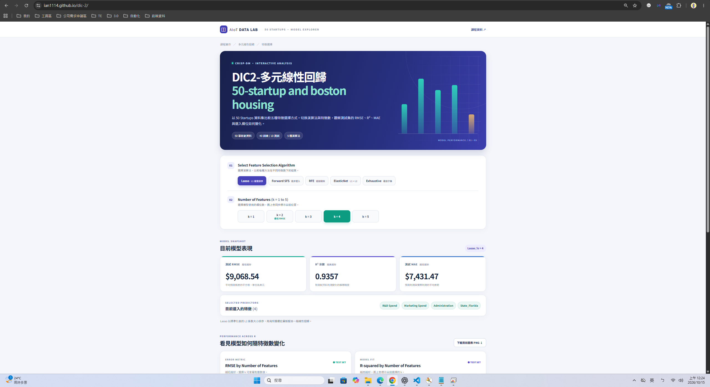

# 50 Startups 特徵選擇互動網頁

本網站以課程的 `50_Startups.csv` 比較五種特徵選擇方法。按「Select Feature Selection Algorithm」和「Number of Features (k = 1 to 5)」即可同步切換指標、選入特徵、兩張圖與結果表；「下載目前圖表 PNG」可儲存目前畫面中的兩張圖。

## 開啟網站

- GitHub Repository: https://github.com/Ian1114/dic-2
- Live Demo: https://ian1114.github.io/dic-2/

## 網站畫面



## 更新模型資料

先安裝 `requirements.txt` 中的 Python 套件，再執行：

```powershell
python generate_data.py
```

這會從 `data/50_Startups.csv` 重算 `results.json` 與 `results.js`。網站讀取 `results.js`，所以部署後不需要 Python 伺服器。

資料固定以 80% 訓練、20% 測試切分，`random_state=0`；California 是州別的基準。特徵選擇在訓練資料上進行；Forward SFS 與 Exhaustive Search 使用 5 折交叉驗證。所有方法選完特徵後，均以一般線性迴歸在同一組測試資料上計算 RMSE、R² 與 MAE。

## GitHub Pages

將本資料夾的內容放在儲存庫根目錄後，於 GitHub 的 **Settings → Pages** 選擇 **Deploy from a branch**，分支 `main`、資料夾 `/ (root)`。頁面會由根目錄的 `index.html` 載入。

課堂附圖第 5 列將最後一個特徵寫成 `State_California`，但其 RMSE 9137.990153 是完整五欄模型（含 `Administration`）的結果。本網站以實際重算的欄位名稱顯示。
